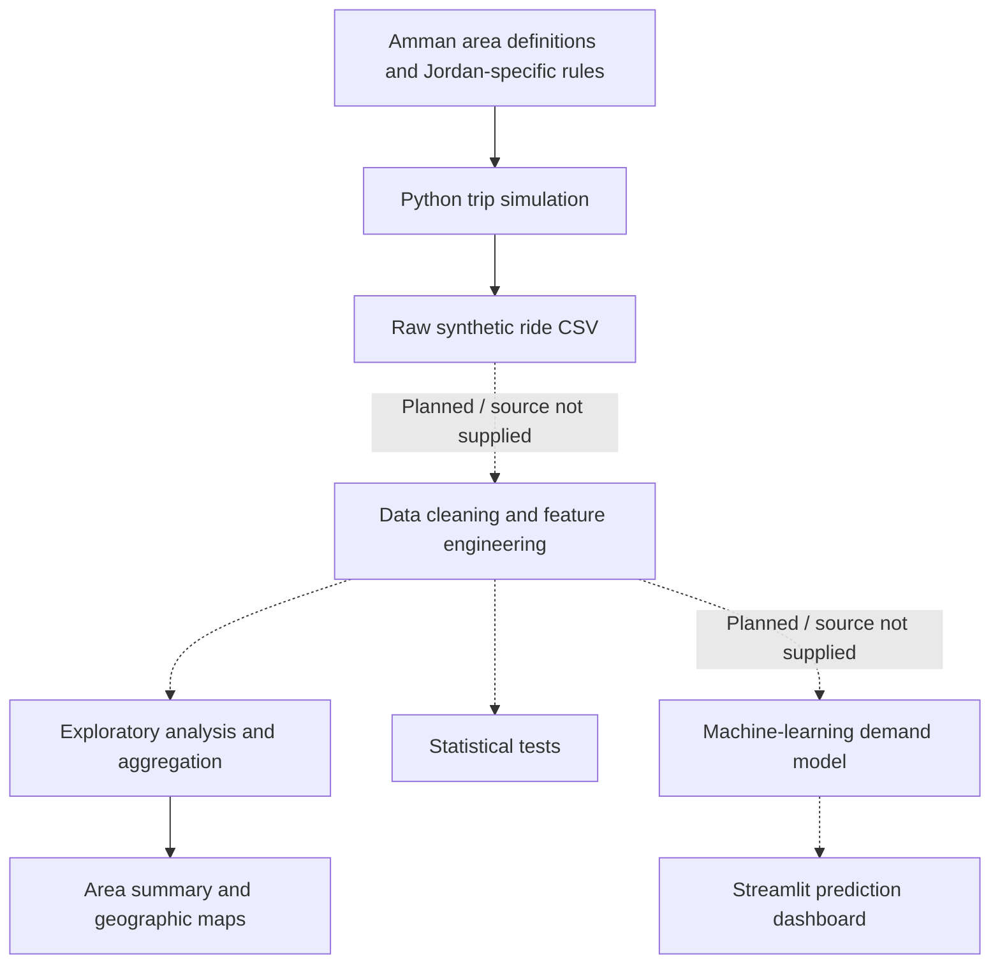

# 🚗 Amman Ride-Hailing Demand Forecasting

Student: Mohammad Almousa  


University: Zarqa University  

## Goal
Predict ride demand across Amman using ML and local patterns.

**A location-aware data science project for understanding ride-hailing activity across Amman, Jordan.**

This project simulates Uber/Careem-style ride records, studies how demand and fares vary by area and time, and visualizes activity on interactive maps. Its broader project plan also includes data cleaning, statistical analysis, machine-learning demand forecasting, and a Streamlit dashboard.

> **Data disclosure:** The trips are **synthetic (computer-generated)**, not actual bookings from Uber, Careem, or another operator. Figures and findings describe the simulated dataset and should not be treated as measurements of real demand in Amman. The project is not affiliated with any ride-hailing provider.

## Table of contents

- [Project overview](#project-overview)
- [Objectives](#objectives)
- [What is included](#what-is-included)
- [How the system works](#how-the-system-works)
- [Dataset](#dataset)
- [Interactive maps and example findings](#interactive-maps-and-example-findings)
- [Statistical analysis](#statistical-analysis)
- [Technologies](#technologies)
- [Installation and usage](#installation-and-usage)
- [Project files](#project-files)
- [Documentation and development roadmap](#documentation-and-development-roadmap)
- [Limitations](#limitations)

## Project overview

Ride-hailing demand is not evenly distributed throughout a city. It can change depending on the pickup area, hour, type of neighborhood, commuting patterns, and the local weekend. The **Amman Ride-Hailing Demand Analysis & Forecasting** project explores these relationships through a Jordan-specific simulation and analytical workflow.

The dataset represents **15 named areas in and around Amman**, including Abdali, Downtown, Sweifieh, Shmeisani, University Street, Khalda, and Queen Alia Airport. The simulation explicitly recognizes **Friday and Saturday as weekend days** and adjusts some trip characteristics for commuting, commercial, shopping, university, industrial, and airport contexts.

The simulator is configured to generate **30,000 rides** dated **March 1–31, 2026**. Each record includes a trip origin and destination, geographic coordinates, distance, travel duration, fare, surge multiplier, and time-related fields.

## Objectives

1. **Simulate trips:** Create a reproducible dataset of ride-hailing activity across Amman.
2. **Understand geographic patterns:** Compare ride counts, average fares, and simulated revenue between areas.
3. **Understand time patterns:** Study weekday/weekend differences and rush-hour effects.
4. **Visualize the results:** Provide interactive location-based maps and a pickup heatmap.
5. **Evaluate relationships:** Use statistical tests to compare groups in the dataset.
6. **Forecast area-level demand:** The full project guide proposes predicting the number of rides for an area and time window using machine learning.
7. **Support decision-making:** Explore how area/time demand estimates could inform driver positioning and operational planning.

## What is included

The uploaded project materials confirm the following components:

| Component | Status in the supplied files | Description |
| --- | --- | --- |
| Amman area configuration | **Included** | Coordinates, relative sampling weights, and area types for 15 areas. |
| Synthetic trip generator | **Included** | Python code configured to generate 30,000 trip records. |
| Area validation helper | **Included** | Prints configured areas, weekend/rush-hour settings, and weights. |
| Area summary | **Included** | CSV with ride totals, average fares, total simulated revenue, and average surge by area. |
| Geospatial visualizations | **Included** | Four interactive HTML maps: base map, pickup heatmap, demand map, and revenue map. |
| Statistical testing | **Included** | Python script for fare and surge comparisons. |
| ETL / cleaning source code | **Not in supplied files** | Described in the project guide; required output for the statistics script is not supplied. |
| Trained forecasting model | **Not in supplied files** | XGBoost-based forecasting is described in the guide, but model/training artifacts were not provided. |
| Streamlit dashboard | **Not in supplied files** | Described as an intended presentation layer in the guide; app code was not provided. |

This status refers to **the files available for this README**, not necessarily every file in the original developer's complete project.

## How the system works



**Solid connections** show directly represented project components; **dotted connections** indicate intended or inferred pipeline steps for which the relevant source/output was not included.

### Simulation logic

The simulation code uses the following rules:

- **Area-based sampling:** Pickup areas are selected from the 15 configured locations using relative weights.
- **Geographic coordinates:** Coordinates are sampled near each area's configured center, with small random variation.
- **Trip destinations:** Each destination is selected from a different configured area.
- **Estimated distance:** Distance is approximated from area-center coordinates with random variation; it is not obtained from a road-routing API.
- **Traffic impact:** Estimated travel speed is reduced during defined rush hours.
- **Surge pricing:** The multiplier can increase during rush hours, during certain evening shopping/commercial periods, and for Queen Alia Airport pickup trips.
- **Reproducibility:** The generator initializes its Python and NumPy random seeds to `42`.

**Configured Jordan-specific rules**

| Rule | Setting |
| --- | --- |
| Weekend | Friday and Saturday |
| Weekday morning rush hours | 07:00–09:59 (hours 7, 8, and 9) |
| Weekday evening rush hours | 16:00–20:59 (hours 16 through 20) |
| Maximum simulated surge multiplier | 2.5× |
| Trip generation period | March 2026 |
| Generated trip count | 30,000 |

### Simulated fare calculation

The generator calculates a fare in Jordanian dinars (JOD) using a base charge, distance, travel time, a booking fee, and the surge multiplier:

```text
fare_jod = max(
    1.50,
    (0.75 + 0.35 * distance_km + 0.08 * duration_min + 0.25)
    * surge_multiplier
)
```

These are **simulation assumptions**, not a claim about an actual ride-hailing provider's fare policy.

## Dataset

### Dataset design

Each simulated row represents **one trip**, not one area-level demand forecast. The generator outputs the raw dataset at:

```text
data/raw/rides_amman.csv
```

The raw trip schema contains **18 fields**:

| Field | Meaning |
| --- | --- |
| `ride_id` | Unique simulated ride identifier. |
| `pickup_datetime` | Trip start date and time. |
| `dropoff_datetime` | Estimated trip end date and time. |
| `pickup_area` | Area in which the ride starts. |
| `dropoff_area` | Destination area. |
| `pickup_lat`, `pickup_lon` | Simulated pickup coordinates. |
| `dropoff_lat`, `dropoff_lon` | Simulated dropoff coordinates. |
| `trip_distance_km` | Estimated trip distance in kilometers. |
| `trip_duration_min` | Estimated trip duration in minutes. |
| `surge_multiplier` | Simulated dynamic-pricing multiplier. |
| `fare_amount_jod` | Simulated fare in Jordanian dinars. |
| `day_of_week` | Weekday name. |
| `hour_of_day` | Pickup hour, from 0 to 23. |
| `hour_12` | Human-readable 12-hour pickup time. |
| `is_weekend` | Whether the date is Friday or Saturday. |
| `is_rush_hour` | Whether the trip starts during a defined weekday rush hour. |

### Geographic coverage

The configured areas are Abdali, Downtown, Jabal Amman, Sweifieh, Khalda, University Street, Tabarbour, Marka, Mecca Street, City Mall Area, Airport Road, Queen Alia Airport, Sahab, Madaba Road, and Shmeisani.

### Aggregated area summary

The supplied `area_summary.csv` has one row per area with:

`area`, `total_rides`, `avg_fare`, `total_revenue`, `avg_surge`, `lat`, and `lon`.

The area summary is a **derived artifact**. Its generation script and the source processed dataset were not provided, so its exact transformation history cannot be independently reproduced from the supplied files alone.

## Interactive maps and example findings

Four ready-to-open HTML visualizations are included. Open them in a modern web browser; base-map tiles and JavaScript dependencies may require an internet connection.

| Map | File | Purpose |
| --- | --- | --- |
| Base map | [`01_amman_base_map.html`](01_amman_base_map.html) | Geographic reference map centered on Amman. |
| Pickup heatmap | [`02_pickup_heatmap.html`](02_pickup_heatmap.html) | Visualizes the density of simulated pickup coordinates. |
| Area demand map | [`03_area_demand_map.html`](03_area_demand_map.html) | Compares simulated ride counts by pickup area. |
| Area revenue map | [`04_area_revenue_map.html`](04_area_revenue_map.html) | Compares simulated fare revenue across areas. |

### Example observations from `area_summary.csv`

| Area | Total rides | Average fare | Total simulated revenue |
| --- | ---: | ---: | ---: |
| Abdali | 3,329 | 5.88 JOD | 19,579.20 JOD |
| Downtown | 2,939 | 6.49 JOD | 19,085.47 JOD |
| Shmeisani | 2,900 | 5.95 JOD | 17,245.19 JOD |
| Sweifieh | 2,601 | 6.42 JOD | 16,698.43 JOD |
| Queen Alia Airport | 946 | 19.40 JOD | 18,351.99 JOD |

In this particular summary, **Abdali has the highest ride count**, while **Queen Alia Airport has the highest average fare**. These comparisons are descriptive results from synthetic records, not independently verified statements about Amman's real ride-hailing market.

**Data-quality note:** The supplied area summary sums to **29,998 rides**, whereas the generator is configured to create **30,000**. This may reflect processing or filtering, but the intermediate dataset and cleaning code were not included, so the precise reason is unconfirmed.

## Statistical analysis

The supplied `statistical_analysis.py` reads a cleaned dataset from `data/processed/rides_amman_clean.csv` and performs these comparisons:

| Method | Question | Variables |
| --- | --- | --- |
| Welch's independent-samples t-test | Do mean fares differ between rush and non-rush hours? | `fare_amount_jod` grouped by `is_rush_hour` |
| One-way ANOVA | Do mean fares differ across pickup areas? | `fare_amount_jod` grouped by `pickup_area` |
| Mann–Whitney U test | Does surge differ between weekdays and weekends? | `surge_multiplier` grouped by `is_weekend` |

The script reports test statistics, p-values, and significance decisions using a threshold of `0.05`. **Numerical statistical results are not reproduced here** because the required cleaned CSV and a verified execution log were not included.

Statistical significance in simulated data demonstrates a difference **within the simulation**; it does not establish causality or prove a real-world market pattern.

## Technologies

| Tool | Role | Evidence/status |
| --- | --- | --- |
| Python | Project programming language | Supplied source code |
| pandas | CSV creation and tabular data processing | Used in supplied code |
| NumPy | Random sampling and numerical calculations | Used in supplied generator |
| SciPy | Statistical hypothesis tests | Used in supplied statistics script |
| Folium / Leaflet | Interactive geospatial mapping | Folium-generated HTML outputs supplied |
| scikit-learn | Preprocessing and model evaluation | Proposed in the project guide |
| XGBoost | Demand prediction model | Proposed in the project guide |
| Streamlit | Interactive forecasting dashboard | Proposed in the project guide |
| matplotlib / seaborn | Data visualization and analysis | Proposed in the project guide |

## Installation and usage

### Prerequisites

- Python 3.10 or later is a reasonable starting point; the project's supported Python versions have not been independently tested.
- `pip` and a terminal (or VS Code / PyCharm).
- A web browser for the HTML maps.

### 1. Arrange the Python scripts

The provided Python files were supplied separately, but their imports and filesystem paths assume a project package structure. Before running them, arrange them as follows:

```text
amman-ride-demand/
├── README.md
├── area_summary.csv
├── 01_amman_base_map.html
├── 02_pickup_heatmap.html
├── 03_area_demand_map.html
├── 04_area_revenue_map.html
├── amman_ride_demand_full_guide.pdf
├── data/
│   ├── raw/                    # created by the simulator if missing
│   └── processed/              # cleaned data needed for statistical tests
└── src/
    ├── data_design/
    │   ├── amman_areas.py
    │   ├── check_areas.py
    │   └── simulate_rides.py
    └── statistics/
        └── statistical_analysis.py
```

Create the directories and **move** the Python files to these locations (the directories may be Python namespace packages; adding empty `__init__.py` files is also fine). Keep the repository root as your working directory when running the commands below.

### 2. Create an environment and install core dependencies

**macOS / Linux:**

```bash
python3 -m venv .venv
source .venv/bin/activate
python -m pip install --upgrade pip
python -m pip install numpy pandas scipy
```

**Windows (PowerShell):**

```powershell
py -m venv .venv
.venv\Scripts\Activate.ps1
python -m pip install --upgrade pip
python -m pip install numpy pandas scipy
```

The HTML map files are already rendered and do not need Python packages just to be viewed.

### 3. Inspect the configured Amman areas

```bash
python -m src.data_design.check_areas
```

This prints the number of areas, weekend days, rush-hour definitions, and each area's weight and type.

### 4. Generate synthetic ride data

```bash
python -m src.data_design.simulate_rides
```

Expected output: `data/raw/rides_amman.csv` with **30,000 rows** and the **18-column schema** documented above. The script uses fixed seeds so reruns with compatible library behavior are reproducible.

### 5. View the interactive maps

Open the four HTML files listed under [Interactive maps and example findings](#interactive-maps-and-example-findings). Move and zoom the map to inspect Amman's geographic patterns; supported markers can be selected to show area-level values.

### 6. Run the statistical tests (requires an additional file)

The statistical script expects a cleaned CSV at:

```text
data/processed/rides_amman_clean.csv
```

Once the cleaned file with the expected columns has been created by the full ETL workflow or supplied by the project developer, run:

```bash
python -m src.statistics.statistical_analysis
```

**Important:** The cleaning code/cleaned CSV was not part of this package. Do not label the raw synthetic CSV as "cleaned" merely to make the test script run.

## Project files

| Supplied file | Description |
| --- | --- |
| `amman_areas.py` | Defines the 15 areas, centers, weights, types, weekend, and rush hours. |
| `check_areas.py` | Checks and prints area configuration. |
| `simulate_rides.py` | Generates trip-level synthetic CSV data. |
| `statistical_analysis.py` | Runs three statistical comparisons against the cleaned data. |
| `area_summary.csv` | Stores the supplied area-level metrics. |
| `01_amman_base_map.html` | Base map. |
| `02_pickup_heatmap.html` | Pickup density heatmap. |
| `03_area_demand_map.html` | Area-level demand visualization. |
| `04_area_revenue_map.html` | Area-level simulated revenue visualization. |
| `amman_ride_demand_full_guide.pdf` | Project handbook describing the complete ten-phase plan. |

## Documentation and development roadmap

The full project guide organizes development into **ten phases**:

1. Environment setup and project structure.
2. Amman area and data design.
3. Synthetic trip simulation.
4. ETL and data cleaning.
5. Exploratory data analysis (EDA).
6. Geospatial analysis.
7. Statistical testing.
8. Forecasting feature engineering.
9. Machine-learning model training and evaluation.
10. Dashboard, final report, and portfolio packaging.

The **planned forecast target** is an aggregated **ride count per area/time combination**, rather than the fare of an individual trip. The guide recommends evaluating forecasts with regression metrics such as MAE, RMSE, and percentage error, and presenting predictions through a Streamlit app where a user selects an area, day, and hour.

For a complete academic documentation submission, this README can serve as the entry point to separate **process documentation**, **product/system documentation**, **technical documentation**, and **user/task-oriented guides**. Screenshots, verified model metrics, installation details for the full app, and usability-test results should be added only after the relevant artifacts have been reviewed or tested.

## Limitations

- **Synthetic data:** The records are generated from assumptions and randomness, not actual ride bookings.
- **No real-time integrations:** The supplied code does not connect to live traffic, weather, pricing, or booking APIs.
- **Approximate geography:** Trip distances and coordinates use simulated estimates rather than actual road networks.
- **Limited time period:** The generator simulates one month, March 2026.
- **Unverified downstream pipeline:** The cleaning code, model files, app code, and training/evaluation results were not present in the reviewed upload set.
- **Summary reconciliation:** The ride-count difference between the generator setting and the supplied area summary remains to be checked against the full data-processing pipeline.

---

**Project scope:** Academic exploration of synthetic ride-hailing data, analytics, geospatial visualization, and a proposed forecasting application for Amman, Jordan.
